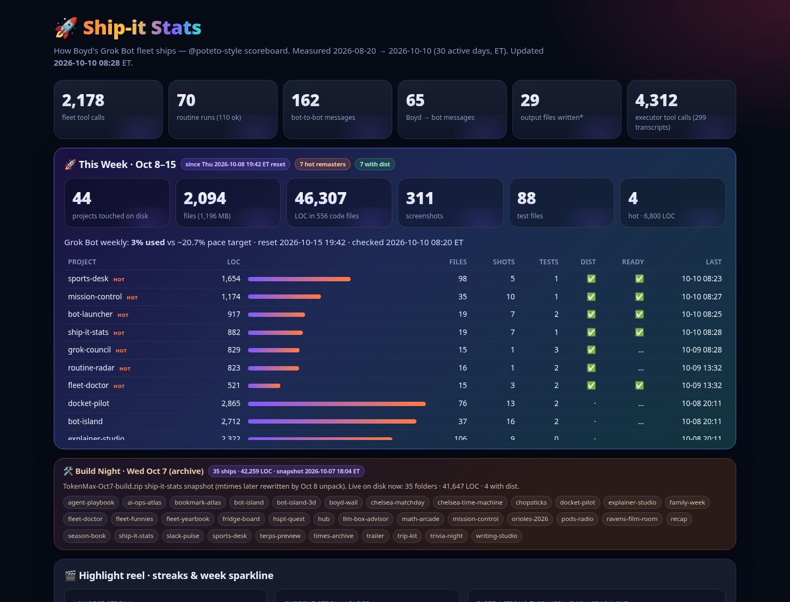
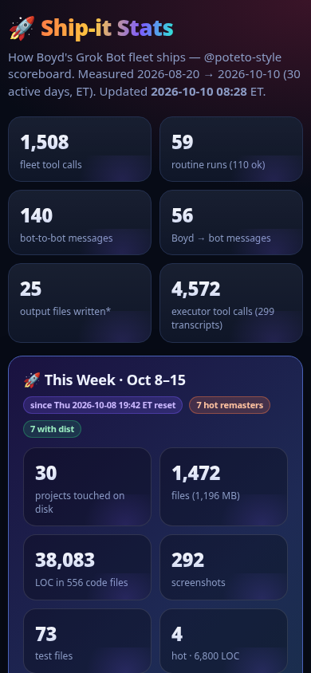

# 🚀 Ship-it Stats

**A @poteto-style "how I shipped N PRs" scoreboard for Boyd's own agent work.** It charts tool calls, routine runs,
files written and bot-to-bot messages per bot per day, with streaks, leaderboards, a highlight reel, and a live
**🚀 This Week (Oct 8–15)** panel for everything TokenMax touched since the Thu ~7:42 PM ET Grok Bot weekly reset.
Inspired by @poteto's "here's how i shipped 2,500 PRs last month" (https://x.com/poteto/status/2102050467505430555);
idea #3 in ../SHORTLIST.md.



| Share card (1200×675) | Phone |
|---|---|
|  |  |

## Run it

```bash
cd /workspace/tokenmax/ship-it-stats
./run.sh                      # collects fresh stats, then serves http://127.0.0.1:4260 (nohup, idempotent)
python3 export_static.py      # dist/ship-it-stats-snapshot.html — one offline file:// HTML
./screenshot.sh               # screenshots/00-best-home.png + share-card.png (headless Chrome)
python3 tests/smoke_test.py   # smoke test
```

Python 3 stdlib only. `?metric=toolCalls` (or routineRuns, filesWritten, msgsSent, boydMsgs) switches the heatmap, and
`?view=card` renders the share card. `/api/refresh` re-runs the collector.

**Offline path:** open `dist/ship-it-stats-snapshot.html` directly in a browser (no server needed).

## What's new (Sat Oct 10 remaster)

* **This Week (Oct 8–15)** panel replaces the old live "Build Night · Oct 7" block: every `/workspace/tokenmax/*`
  project with mtime activity since the Thu Oct 8 ~7:42 PM ET reset, with files / LOC / screenshots / tests / dist
  presence. **Hot** rows are remasters or new builds on/after Fri Oct 9 (after the Oct 8 unpack).
* **Build Night Oct 7 archive strip**: frozen totals from the Oct 7 6:04 PM ET snapshot (35 projects · 42,259 LOC),
  because the Oct 8 unpack rewrote live mtimes and can no longer recover that night.
* **Animated count-up** headline KPIs and streak numbers.
* **Streak + highlight reel** with longest/current streak leaders and a **daily sparkline of fleet tool calls**
  for the current week.
* Darker scoreboard CSS tuned for share cards.
* Collector refreshed against live `/home/box/agent-data` (audits, automations runs, transcript metadata only).

## What's on the page

* **Headline numbers** (count-up): fleet tool calls, routine runs, bot-to-bot messages, Boyd → bot messages,
  output files written, executor sub-agent tool calls.
* **This Week · Oct 8–15**: projects touched since reset, hot remasters, LOC/files/shots/tests/dist, usage.json pace.
* **Build Night archive strip**: Oct 7 ships still named on disk + frozen snapshot totals.
* **Highlight reel + streak banner + week sparkline**.
* **Bots × days heatmap**, leaderboards, streaks table, fleet actions/day, top tools/apps, who-talks-to-whom.
* **How it's measured**: every caveat, printed on the page.

## Where the numbers come from (read-only)

| Number | Source |
|---|---|
| Tool calls | each bot's `audit.jsonl` (MCP + shell + browser + computer-use), via `bot-island/collect.py` |
| Routine runs | every entry in `automations/*/runs.json` |
| Bot-to-bot / Boyd messages | who/when metadata from each bot's transcript store (no contents) |
| Files written | Bot Island's output-folder mapping, 1 per minute, last 30 days |
| Executor tool calls | `tool_use` names counted in `/home/box/agent-data/agent-transcripts/sand-subagent-*/*.jsonl` |
| This Week | `hub/scan.py` `project()` + newest-file mtime ≥ Thu Oct 8 19:42 ET |
| Build Night archive | frozen totals from `TokenMax-Oct7-build.zip` ship-it-stats snapshot (2026-10-07T18:04:22-04:00) |

**Not measured** (shown as such on the page):
- Bots without `audit.jsonl` — a 0 means "not measured", not zero activity.
- Executor transcripts have no per-line timestamps or parent bot; shared restore mtimes make per-day splits unreliable.
- Many folders share an Oct 8 ~8:11 PM ET mtime from the unpack — they count as This Week on-disk but are not "hot".

Collector writes only `data/stats.json` here. It imports Bot Island's and the Hub's code with bytecode writing off, so
nothing is written into those folders. The smoke test checks that.


---
## Repo notes
- **Built:** 2026-10-07, by TokenMax (Boyd's Grok Bot) on the Grok Bot box.
- **Run:** `./run.sh` (then open the localhost URL it prints).
- Imported from `/workspace/tokenmax/ship-it-stats` on Oct 23, 2026. node_modules, virtualenvs, logs and files over 20 MB were left out.
